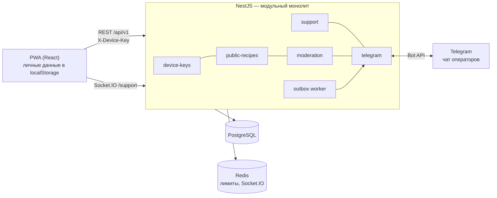

# Архитектура backend MILO (этап 2)

Решения — `DECISIONS.md` (B-1…B-15), ADR — `adr/`, данные — `database.md`, контракты — `api.md`.

> **Изменено 2026-11-05 (B-15, ADR-0004):** поддержка — **отдельный сервис** `support/` на отдельном VPS со своей базой, своим анонимным ключом и своим Telegram-ботом. Ниже описание ещё в виде одного сервера: модули `support` и бот обращений из `telegram` переезжают в `support/`, в основном сервере остаётся бот модерации. Разделы 2–4 и 7 обновить при начале этапа 8.

## 1. Назначение

Сервер **не хранит личные данные** (B-6). Приложение остаётся офлайн-PWA: профиль, кладовая, дневник, покупки и личные рецепты — в `localStorage` устройства, как сейчас. Сервер добавляет две функции, которым нужна сеть:

1. **Каталог публичных рецептов**: пользователь публикует свой рецепт, другие находят его и добавляют себе (B-7, B-9).
2. **Поддержка**: анонимный чат в приложении, операторы отвечают из Telegram (B-10).

Без сети приложение работает как раньше; недоступны только каталог и чат.

## 2. Схема

## 3. Модули NestJS

| Модуль           | Ответственность                                                                                                 | Зависит от             |
| ---------------- | --------------------------------------------------------------------------------------------------------------- | ---------------------- |
| `config`         | загрузка и валидация ENV при старте (неверный конфиг — процесс не стартует)                                     | —                      |
| `prisma`         | `PrismaService`, транзакции, преобразование ошибок БД в HTTP                                                    | config                 |
| `common`         | единый формат ошибок (фильтр), `ValidationPipe`, курсорная пагинация, `Idempotency-Key`-интерсептор, request id | —                      |
| `health`         | `/health`, `/health/ready`                                                                                      | prisma, redis          |
| `device-keys`    | выдача ключа, `DeviceKeyGuard` (хэш → `request.deviceKey`), удаление данных устройства, блокировка              | prisma                 |
| `public-recipes` | публикация, правка, удаление, каталог, поиск, расчёт КБЖУ на порцию                                             | device-keys, prisma    |
| `moderation`     | жалобы, скрытие/возврат рецепта, блокировка ключа, журнал                                                       | public-recipes, outbox |
| `support`        | обращения, сообщения, WebSocket-шлюз                                                                            | device-keys, outbox    |
| `telegram`       | бот (grammY): отправка в чат операторов, приём ответов и кнопок модерации, дедупликация обновлений              | support, moderation    |
| `outbox`         | запись событий в транзакции, фоновая отправка с повторами                                                       | prisma                 |
| `rate-limit`     | `@nestjs/throttler` с хранилищем в Redis, ключ лимита = IP или device key                                       | redis                  |

Модули общаются через публичные сервисы и доменные события, без доступа к чужим таблицам. Каждый модуль лежит в `backend/src/modules/<name>/` и делится на `*.controller.ts`, `*.service.ts`, `dto/`, `*.spec.ts`.

## 4. Ключевые сценарии

### Публикация рецепта (клиент → сервер)

1. Пользователь нажимает «Опубликовать» в своём рецепте. Если ключа ещё нет, клиент получает его: `POST /device-keys` → сохраняет в хранилище через `shared/lib/storage`.
2. Клиент строит **снимок**: по каждому ингредиенту берёт из продукта кладовой название, единицу, вес штуки и КБЖУ на 100 г (ADR-0002). Остатки, `minStock` и id продуктов не отправляются.
3. `POST /public-recipes` с `Idempotency-Key`. Сервер проверяет диапазоны, вычисляет КБЖУ на порцию (те же формулы, что `recipeNutrition` и `toGrams` на клиенте; общие тест-кейсы), сохраняет рецепт.
4. Клиент записывает в локальный рецепт `publishedId` и `publishedVersion` (persist-миграция `milo:recipes` v1 → v2 на этапе 7). Повторная публикация того же рецепта = `PUT` по `publishedId`.

### «Добавить себе» (сервер → клиент)

Из каталога клиент создаёт **копию** в `milo:recipes` (со ссылкой `sourcePublicId`). Каждый ингредиент сопоставляется с продуктом кладовой по названию (без регистра и лишних пробелов) и совпадающей единице. Если подходящего продукта нет, создаётся продукт с остатком 0 и КБЖУ из снимка. Перед сохранением пользователь видит, какие продукты будут созданы. Это чистая функция в `entities/recipe` с тестами.

### Жалоба и модерация

1. `POST /public-recipes/:id/reports` → строка жалобы и событие `recipe.reported` в outbox (одна транзакция).
2. Outbox-воркер отправляет в чат операторов сообщение: название, ссылку на рецепт, причину, число жалоб. Кнопки: «Скрыть», «Оставить», «Заблокировать автора». Связь сообщения и жалобы записывается в `telegram_message_links`.
3. Оператор нажимает кнопку → сервер проверяет, что `from.id` — активный оператор, выполняет действие в транзакции и пишет его в `moderation_actions`, затем меняет сообщение в чате («Скрыто — Анна»).

### Обращение в поддержку

1. Пользователь пишет на экране «Поддержка» в профиле → `POST /support/tickets` → событие `ticket.created`.
2. Бот публикует в чате операторов «Обращение № 42» с текстом. Оператор отвечает на это сообщение (reply) → сервер находит обращение по `telegram_message_links`, сохраняет `SupportMessage(author=operator)`, ставит статус `answered` и отправляет `message.created` через WebSocket.
3. Новые сообщения пользователя уходят в тот же тред бота (reply на исходное сообщение).

## 5. Защита от злоупотреблений

Аккаунтов нет, поэтому основная защита — лимиты (Redis, скользящее окно) и модерация.

| Действие                   | Лимит          | Ключ лимита |
| -------------------------- | -------------- | ----------- |
| Выдача ключа устройства    | 5 в час        | IP          |
| Чтение каталога и рецептов | 120 в минуту   | IP          |
| Публикация рецепта         | 10 в сутки     | device key  |
| Правка / удаление рецепта  | 60 в час       | device key  |
| Жалоба                     | 20 в сутки     | device key  |
| Новое обращение            | 5 в сутки      | device key  |
| Сообщение в обращении      | 30 за 10 минут | device key  |
| Все запросы с одного IP    | 600 в минуту   | IP          |

Блокировка ключа оператором запрещает запись. Повторные жалобы на один рецепт с одного устройства отклоняются (`409`). Порог автоскрытия не вводится: решение всегда за оператором (B-9).

## 6. Безопасность и приватность

- Ключ устройства: 32 случайных байта (`crypto.randomBytes`), формат `mk_<base64url>`. В базе только SHA-256: медленный хэш не нужен, так как у ключа высокая энтропия (ADR-0001). Сравнение — поиск по уникальному хэшу.
- Ключ не пишется в логи (`pino` redact для `x-device-key` и `auth.deviceKey`); тексты рецептов и обращений тоже не логируются. IP — только в логах доступа, хранение не дольше 14 дней.
- `helmet`; CORS — только адреса из `CORS_ORIGINS`; размер тела ≤ 64 КБ; `ValidationPipe` с `whitelist` и `forbidNonWhitelisted`.
- Webhook Telegram — проверка секретного заголовка. Действия в боте — только от `telegram_user_id` активного оператора и только в чате `TELEGRAM_OPERATORS_CHAT_ID`.
- Секреты — только ENV: `DATABASE_URL`, `REDIS_URL`, `TELEGRAM_BOT_TOKEN`, `TELEGRAM_WEBHOOK_SECRET`, `TELEGRAM_OPERATORS_CHAT_ID`, `CORS_ORIGINS`, `PORT`, `LOG_LEVEL`. В репозитории — только `.env.example`.
- Удаление: `DELETE /device-keys/me` стирает всё, что связано с устройством. В PWA — кнопка «Удалить мои данные с сервера» в профиле.

## 7. Интеграция во frontend (этап 7, по FSD)

| Слой       | Что появится                                                                                                                                                                                                                                                                |
| ---------- | --------------------------------------------------------------------------------------------------------------------------------------------------------------------------------------------------------------------------------------------------------------------------- |
| `shared`   | `api`: HTTP-клиент (`fetch`, `VITE_API_URL`, `X-Device-Key`, `Idempotency-Key`, разбор ошибок по `code`); `QueryClientProvider` в `app/providers`                                                                                                                           |
| `entities` | `device-key` (хранение ключа через `shared/lib/storage`), `public-recipe` (типы, query-ключи, запросы); `recipe`: поля `publishedId`, `publishedVersion`, `sourcePublicId` (persist v2 + `migrate`), снимок для публикации и сопоставление «Добавить себе» — чистые функции |
| `features` | `publish-recipe`, `report-recipe`, `add-public-recipe`, `send-support-message`, `delete-server-data`                                                                                                                                                                        |
| `widgets`  | `public-recipe-list` (каталог с поиском и «Ещё»), `support-chat`                                                                                                                                                                                                            |
| `pages`    | каталог и публичный рецепт; «Поддержка» в профиле                                                                                                                                                                                                                           |

Без сети или если `VITE_API_URL` не задан, кнопки «Опубликовать» и каталог показывают понятное состояние «Нужен интернет», остальное приложение не меняется.

## 8. Окружения

| Окружение | Как запускается                                                                                                     |
| --------- | ------------------------------------------------------------------------------------------------------------------- |
| dev       | `docker compose up` (PostgreSQL 17, Redis) + `npm run start:dev -w backend`; бот — long polling (если задан токен)  |
| test      | Jest: unit — без БД; интеграционные (supertest) — отдельная база в Docker, миграции перед запуском; Telegram — mock |
| CI        | та же проверка `lint · typecheck · test · build` (B-5), PostgreSQL и Redis как services                             |
| prod      | развёртывание запрещено до отдельного решения владельца (B-1); webhook вместо polling                               |

## 9. Открытые вопросы (не блокируют этапы 3–6)

| Вопрос                                      | Предложение                                                                                                 |
| ------------------------------------------- | ----------------------------------------------------------------------------------------------------------- |
| Где во frontend каталог                     | кнопка «Каталог» на вкладке «Рецепты» → отдельная страница `/catalog` (4-я вкладка не помещается на 360 px) |
| Шаги приготовления в рецепте                | в клиенте их нет; добавлять отдельным решением (и в личные, и в публичные рецепты)                          |
| Фото и вложения                             | нет (риск личных данных, нужна модерация изображений); отдельное решение                                    |
| Политика контента и конфиденциальности (В6) | нужна до production                                                                                         |
