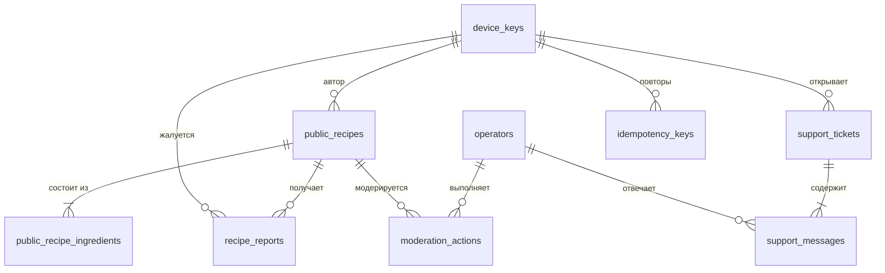

# База данных backend MILO (этап 2)

PostgreSQL 17, Prisma 7.10.1. Концепция — `DECISIONS.md` B-6…B-11: личных данных пользователя (профиль, кладовая, дневник, покупки, личные рецепты) в базе **нет**. Хранятся только опубликованные рецепты, жалобы, анонимные обращения в поддержку и служебные таблицы. Черновик схемы — `schema.draft.prisma`.

## Соглашения

- Первичные ключи — `uuid` (генерирует сервер, `gen_random_uuid()`); исключения указаны.
- Время — `timestamptz`, UTC. Имена таблиц и колонок — `snake_case` (`@@map` / `@map` в Prisma), модели — `PascalCase`.
- Количества и КБЖУ — `numeric` (не float): количество `numeric(10,2)`, КБЖУ на 100 г `numeric(6,2)`, вес штуки `numeric(8,2)`. Округление при показе — по правилам клиента (`roundAmount`).
- Удаление автором — физическое (минимум данных), с каскадом на дочерние строки.
- IP-адреса и тексты сообщений в базу и логи не пишутся, кроме самих текстов обращений в `support_messages`.

## ER-диаграмма

Служебные таблицы без связей на диаграмме: `telegram_message_links`, `telegram_updates`, `outbox_events`.

## Таблицы

### `device_keys` — анонимный ключ устройства (B-8)

| Колонка        | Тип              | Ограничения / смысл                                                      |
| -------------- | ---------------- | ------------------------------------------------------------------------ |
| `id`           | uuid PK          |                                                                          |
| `key_hash`     | char(64) UNIQUE  | SHA-256 (hex) от ключа; сам ключ сервер не хранит                        |
| `created_at`   | timestamptz      | default now()                                                            |
| `last_seen_at` | timestamptz NULL | обновляется не чаще раза в сутки (без истории)                           |
| `blocked_at`   | timestamptz NULL | ключ заблокирован оператором за спам: запись запрещена, чтение разрешено |

### `public_recipes` — опубликованный рецепт (B-7)

| Колонка                                                       | Тип                   | Ограничения / смысл                                                             |
| ------------------------------------------------------------- | --------------------- | ------------------------------------------------------------------------------- |
| `id`                                                          | uuid PK               |                                                                                 |
| `author_key_id`                                               | uuid FK → device_keys | ON DELETE CASCADE                                                               |
| `name`                                                        | varchar(120)          | 1–120 символов после обрезки пробелов                                           |
| `servings`                                                    | smallint              | 1–100                                                                           |
| `kcal_per_serving`                                            | numeric(8,2)          | вычисляет сервер из снимка ингредиентов (для сортировки и карточки каталога)    |
| `protein_per_serving`, `fat_per_serving`, `carbs_per_serving` | numeric(8,2)          | то же                                                                           |
| `status`                                                      | enum `recipe_status`  | `published` \| `hidden` (скрыт оператором); default `published`                 |
| `version`                                                     | integer               | default 1; +1 при каждой правке (оптимистичная блокировка, 409 при расхождении) |
| `published_at`                                                | timestamptz           | default now()                                                                   |
| `updated_at`                                                  | timestamptz           | `@updatedAt`                                                                    |

Индексы: `(status, published_at DESC, id)` — лента каталога; GIN `pg_trgm` по `lower(name)` — поиск по подстроке (расширение `pg_trgm` в начальной миграции); `(author_key_id)`.

### `public_recipe_ingredients` — снимок ингредиента (ADR-0002)

| Колонка                   | Тип                      | Ограничения / смысл                                       |
| ------------------------- | ------------------------ | --------------------------------------------------------- |
| `id`                      | uuid PK                  |                                                           |
| `recipe_id`               | uuid FK → public_recipes | ON DELETE CASCADE                                         |
| `position`                | smallint                 | порядок в рецепте, 0…49; UNIQUE (`recipe_id`, `position`) |
| `name`                    | varchar(80)              | название продукта на момент публикации                    |
| `amount`                  | numeric(10,2)            | > 0, ≤ 100 000; на весь рецепт, в единице `unit`          |
| `unit`                    | enum `unit`              | `g` \| `ml` \| `pcs`                                      |
| `piece_weight`            | numeric(8,2) NULL        | обязателен при `pcs`: > 0, ≤ 5000 г; иначе NULL           |
| `kcal`                    | numeric(6,2)             | на 100 г: 0–900                                           |
| `protein`, `fat`, `carbs` | numeric(6,2)             | на 100 г: 0–100, сумма ≤ 100                              |

Рецепт содержит 1–50 ингредиентов. При правке набор ингредиентов заменяется целиком (в одной транзакции с `version + 1`).

### `recipe_reports` — жалобы (B-9)

| Колонка           | Тип                      | Ограничения / смысл                                                                    |
| ----------------- | ------------------------ | -------------------------------------------------------------------------------------- |
| `id`              | uuid PK                  |                                                                                        |
| `recipe_id`       | uuid FK → public_recipes | ON DELETE CASCADE                                                                      |
| `reporter_key_id` | uuid FK → device_keys    | ON DELETE CASCADE; UNIQUE (`recipe_id`, `reporter_key_id`) — одна жалоба от устройства |
| `reason`          | enum `report_reason`     | `spam` \| `offensive` \| `not_food` \| `other`                                         |
| `comment`         | varchar(500) NULL        |                                                                                        |
| `status`          | enum `report_status`     | `open` \| `accepted` (рецепт скрыт) \| `dismissed`; default `open`                     |
| `created_at`      | timestamptz              |                                                                                        |
| `resolved_at`     | timestamptz NULL         |                                                                                        |

Индекс: `(status, created_at)`.

### `operators` — операторы в Telegram (B-10)

| Колонка            | Тип           | Ограничения / смысл                                       |
| ------------------ | ------------- | --------------------------------------------------------- |
| `id`               | uuid PK       |                                                           |
| `telegram_user_id` | bigint UNIQUE | id пользователя Telegram                                  |
| `display_name`     | varchar(64)   | имя для ответа в чате поддержки («Оператор Анна»)         |
| `active`           | boolean       | default true; неактивный не может модерировать и отвечать |
| `created_at`       | timestamptz   |                                                           |

Операторы добавляются командой сервера (CLI / seed из ENV), не через API.

### `moderation_actions` — журнал модерации

| Колонка         | Тип                           | Ограничения / смысл                                                                    |
| --------------- | ----------------------------- | -------------------------------------------------------------------------------------- |
| `id`            | uuid PK                       |                                                                                        |
| `operator_id`   | uuid FK → operators           | ON DELETE RESTRICT                                                                     |
| `recipe_id`     | uuid NULL FK → public_recipes | ON DELETE SET NULL (журнал переживает удаление рецепта)                                |
| `device_key_id` | uuid NULL                     | для действий с ключом; без FK (ключ может быть удалён)                                 |
| `action`        | enum `moderation_action`      | `hide_recipe` \| `restore_recipe` \| `dismiss_reports` \| `block_key` \| `unblock_key` |
| `created_at`    | timestamptz                   |                                                                                        |

### `support_tickets` — обращение (B-10)

| Колонка         | Тип                   | Ограничения / смысл                                           |
| --------------- | --------------------- | ------------------------------------------------------------- |
| `id`            | uuid PK               |                                                               |
| `number`        | integer UNIQUE        | последовательность (`autoincrement`), показывается как «№ 42» |
| `device_key_id` | uuid FK → device_keys | ON DELETE CASCADE                                             |
| `status`        | enum `ticket_status`  | `open` \| `answered` \| `closed`; default `open`              |
| `created_at`    | timestamptz           |                                                               |
| `updated_at`    | timestamptz           | время последнего сообщения или смены статуса                  |

Индекс: `(device_key_id, updated_at DESC)`.

### `support_messages` — сообщение в обращении

| Колонка       | Тип                       | Ограничения / смысл                           |
| ------------- | ------------------------- | --------------------------------------------- |
| `id`          | uuid PK                   |                                               |
| `ticket_id`   | uuid FK → support_tickets | ON DELETE CASCADE                             |
| `author`      | enum `message_author`     | `user` \| `operator`                          |
| `operator_id` | uuid NULL FK → operators  | обязателен при `operator`; ON DELETE SET NULL |
| `text`        | varchar(4000)             | 1–4000 символов                               |
| `created_at`  | timestamptz               |                                               |

Индекс: `(ticket_id, created_at, id)` — подгрузка «после сообщения X». Вложений нет (решение этапа 2: фото могут содержать личные данные; добавлять — отдельным решением).

### `telegram_message_links` — связь сообщений бота с обращениями и жалобами

| Колонка      | Тип                            | Ограничения / смысл          |
| ------------ | ------------------------------ | ---------------------------- |
| `chat_id`    | bigint                         | PK (`chat_id`, `message_id`) |
| `message_id` | integer                        |                              |
| `ticket_id`  | uuid NULL FK → support_tickets | ON DELETE CASCADE            |
| `report_id`  | uuid NULL FK → recipe_reports  | ON DELETE CASCADE            |
| `created_at` | timestamptz                    |                              |

Ровно одно из `ticket_id` / `report_id` заполнено (CHECK в миграции). Оператор отвечает «ответом» (reply) на сообщение бота — по этой таблице сервер находит обращение.

### `telegram_updates` — дедупликация обновлений Telegram

| Колонка       | Тип         | Смысл                                        |
| ------------- | ----------- | -------------------------------------------- |
| `update_id`   | bigint PK   | id обновления Telegram; повтор → пропуск     |
| `received_at` | timestamptz | строки старше 7 дней удаляет плановая задача |

### `outbox_events` — исходящие события (ADR-0003)

| Колонка        | Тип               | Смысл                                                                  |
| -------------- | ----------------- | ---------------------------------------------------------------------- |
| `id`           | uuid PK           |                                                                        |
| `type`         | varchar(64)       | `recipe.reported`, `ticket.created`, `ticket.message_from_user`, …     |
| `payload`      | jsonb             | id сущностей, без текстов (текст читается из базы при отправке)        |
| `created_at`   | timestamptz       |                                                                        |
| `processed_at` | timestamptz NULL  | NULL — ещё не отправлено                                               |
| `attempts`     | integer           | default 0; после 10 неудач событие остаётся с `last_error` для разбора |
| `last_error`   | varchar(500) NULL |                                                                        |

Индекс: частичный по `created_at` WHERE `processed_at IS NULL`. Событие пишется в той же транзакции, что и изменение.

### `idempotency_keys` — защита от повторных POST

| Колонка         | Тип                   | Смысл                                                  |
| --------------- | --------------------- | ------------------------------------------------------ |
| `device_key_id` | uuid FK → device_keys | PK (`device_key_id`, `key`); ON DELETE CASCADE         |
| `key`           | varchar(64)           | значение заголовка `Idempotency-Key` (UUID от клиента) |
| `request_hash`  | char(64)              | SHA-256 тела: тот же ключ с другим телом → 422         |
| `status_code`   | smallint              |                                                        |
| `response`      | jsonb                 | сохранённый ответ                                      |
| `created_at`    | timestamptz           | строки старше 24 ч удаляет плановая задача             |

## Удаление данных

`DELETE /api/v1/device-keys/me` удаляет ключ; каскадом — рецепты автора (с ингредиентами, жалобами на них), жалобы и обращения с этого устройства, ключи идемпотентности. Журнал модерации сохраняется без связи с рецептом.
