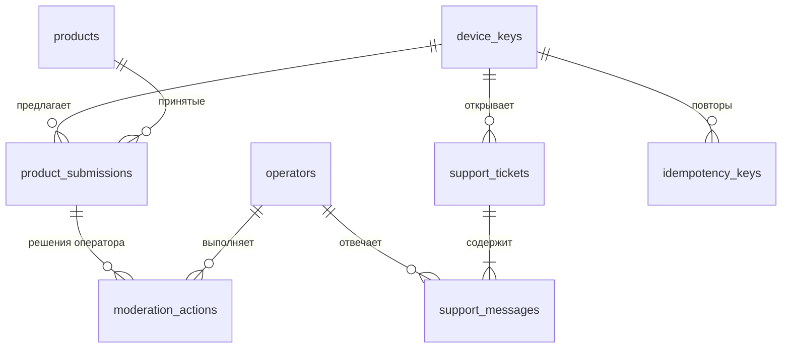

# База данных backend MILO

PostgreSQL 17, Prisma 7.10.1 (драйвер `@prisma/adapter-pg`). Рабочая схема — `backend/prisma/schema.prisma`, миграции — `backend/prisma/migrations/` (CHECK-ограничения и `pg_trgm` — SQL в миграциях). Концепция — `DECISIONS.md` B-6…B-11: личных данных пользователя (профиль, кладовая, дневник, покупки, личные рецепты) в базе **нет**. Хранятся только общая база продуктов и предложения в неё (B-18, ADR-0005), анонимные обращения в поддержку, журнал модерации и служебные таблицы. Черновик схемы — `schema.draft.prisma`.

## Соглашения

- Первичные ключи — `uuid` (генерирует сервер: клиент Prisma, `@default(uuid())`; при вставке в обход Prisma id задаётся явно); исключения указаны.
- Время — `timestamptz`, UTC. Имена таблиц и колонок — `snake_case` (`@@map` / `@map` в Prisma), модели — `PascalCase`.
- Количества и КБЖУ — `numeric` (не float): количество `numeric(10,2)`, КБЖУ на 100 г `numeric(6,2)`, вес штуки `numeric(8,2)`. Округление при показе — по правилам клиента (`roundAmount`).
- Удаление автором — физическое (минимум данных), с каскадом на дочерние строки.
- IP-адреса и тексты сообщений в базу и логи не пишутся, кроме самих текстов обращений в `support_messages`.

## ER-диаграмма

Черновик `schema.draft.prisma` (этап 2) больше не обновляется — источник истины `backend/prisma/schema.prisma`.

Служебные таблицы без связей на диаграмме: `telegram_message_links`, `telegram_updates`, `outbox_events`.

## Таблицы

### `device_keys` — анонимный ключ устройства (B-8)

| Колонка        | Тип              | Ограничения / смысл                                                      |
| -------------- | ---------------- | ------------------------------------------------------------------------ |
| `id`           | uuid PK          |                                                                          |
| `key_hash`     | char(64) UNIQUE  | SHA-256 (hex) от ключа; сам ключ сервер не хранит                        |
| `created_at`   | timestamptz      | default now()                                                            |
| `last_seen_at` | timestamptz NULL | обновляется не чаще раза в час (без истории)                             |
| `blocked_at`   | timestamptz NULL | ключ заблокирован оператором за спам: запись запрещена, чтение разрешено |

### `products` — общая база продуктов (B-18)

| Колонка                   | Тип               | Ограничения / смысл                                                    |
| ------------------------- | ----------------- | ---------------------------------------------------------------------- |
| `id`                      | uuid PK           |                                                                        |
| `name`                    | varchar(120)      | 1–120 символов после обрезки пробелов                                  |
| `brand`                   | varchar(80) NULL  | 1–80 символов, если задан                                              |
| `barcode`                 | varchar(14) NULL  | UNIQUE; 8, 12, 13 или 14 цифр (CHECK); контрольную цифру проверяет API |
| `unit`                    | enum `unit`       | `g` \| `ml` \| `pcs`                                                   |
| `piece_weight`            | numeric(8,2) NULL | обязателен при `pcs`: > 0, ≤ 5000 г; иначе NULL                        |
| `kcal`                    | numeric(6,2)      | на 100 г: 0–900                                                        |
| `protein`, `fat`, `carbs` | numeric(6,2)      | на 100 г: 0–100, сумма ≤ 100                                           |
| `created_at`              | timestamptz       | задаёт приложение с точностью до мс (курсор страниц), без default      |
| `updated_at`              | timestamptz       | `@updatedAt`                                                           |

Индексы: `(created_at DESC, id)` — лента и курсор; GIN `gin_trgm_ops` по `name` — поиск по подстроке (`ILIKE`); UNIQUE `barcode`.

### `product_submissions` — предложения продуктов (B-18, ADR-0005)

Те же поля продукта и те же CHECK, плюс:

| Колонка         | Тип                      | Ограничения / смысл                                                   |
| --------------- | ------------------------ | --------------------------------------------------------------------- |
| `device_key_id` | uuid FK → device_keys    | ON DELETE CASCADE                                                     |
| `status`        | enum `submission_status` | `pending` (ждёт человека) \| `approved` \| `rejected`                 |
| `flags`         | text[]                   | коды замечаний автомодерации (`automod.ts`)                           |
| `reviewed_by`   | enum `reviewed_by` NULL  | `auto` \| `operator`; у `pending` NULL, у решённых обязателен (CHECK) |
| `reviewed_at`   | timestamptz NULL         | так же                                                                |
| `product_id`    | uuid NULL FK → products  | принятое → продукт (новый или существующий); ON DELETE SET NULL       |
| `created_at`    | timestamptz              | задаёт приложение (мс)                                                |

Индексы: `(device_key_id, created_at DESC, id)` — «мои предложения»; `(status, created_at)` — очередь человека; `(barcode)`. Штрихкод здесь не уникален: несколько устройств могут предложить один товар.

### `operators` — операторы в Telegram (B-10)

| Колонка            | Тип           | Ограничения / смысл                                       |
| ------------------ | ------------- | --------------------------------------------------------- |
| `id`               | uuid PK       |                                                           |
| `telegram_user_id` | bigint UNIQUE | id пользователя Telegram                                  |
| `display_name`     | varchar(64)   | имя в ответах поддержки и журнале («Оператор Анна»)       |
| `active`           | boolean       | default true; неактивный не может модерировать и отвечать |
| `created_at`       | timestamptz   |                                                           |

Операторы добавляются командой сервера (CLI / seed из ENV), не через API.

### `moderation_actions` — журнал модерации

| Колонка         | Тип                                | Ограничения / смысл                                                         |
| --------------- | ---------------------------------- | --------------------------------------------------------------------------- |
| `id`            | uuid PK                            |                                                                             |
| `operator_id`   | uuid FK → operators                | ON DELETE RESTRICT                                                          |
| `submission_id` | uuid NULL FK → product_submissions | ON DELETE SET NULL (журнал переживает удаление предложения)                 |
| `device_key_id` | uuid NULL                          | для действий с ключом; без FK (ключ может быть удалён)                      |
| `action`        | enum `moderation_action`           | `approve_submission` \| `reject_submission` \| `block_key` \| `unblock_key` |
| `created_at`    | timestamptz                        |                                                                             |

### `support_tickets` — обращение (B-10)

| Колонка         | Тип                   | Ограничения / смысл                                           |
| --------------- | --------------------- | ------------------------------------------------------------- |
| `id`            | uuid PK               |                                                               |
| `number`        | integer UNIQUE        | последовательность (`autoincrement`), показывается как «№ 42» |
| `device_key_id` | uuid FK → device_keys | ON DELETE CASCADE                                             |
| `status`        | enum `ticket_status`  | `open` \| `answered` \| `closed`; default `open`              |
| `created_at`    | timestamptz           |                                                               |
| `updated_at`    | timestamptz           | время последнего сообщения или смены статуса                  |

Индекс: `(device_key_id, updated_at DESC)`.

### `support_messages` — сообщение в обращении

| Колонка       | Тип                       | Ограничения / смысл                           |
| ------------- | ------------------------- | --------------------------------------------- |
| `id`          | uuid PK                   |                                               |
| `ticket_id`   | uuid FK → support_tickets | ON DELETE CASCADE                             |
| `author`      | enum `message_author`     | `user` \| `operator`                          |
| `operator_id` | uuid NULL FK → operators  | обязателен при `operator`; ON DELETE SET NULL |
| `text`        | varchar(4000)             | 1–4000 символов                               |
| `created_at`  | timestamptz               |                                               |

Индекс: `(ticket_id, created_at, id)` — подгрузка «после сообщения X». Вложений нет (решение этапа 2: фото могут содержать личные данные; добавлять — отдельным решением).

Время `created_at` / `updated_at` обращений и сообщений задаёт приложение с точностью до мс (как у продуктов): курсор списка и дозагрузка `?after=` сравнивают время с точностью `Date`.

### `telegram_message_links` — связь сообщений ботов с обращениями и предложениями

| Колонка         | Тип                                | Ограничения / смысл              |
| --------------- | ---------------------------------- | -------------------------------- |
| `chat_id`       | bigint                             | PK (`chat_id`, `message_id`)     |
| `message_id`    | integer                            |                                  |
| `ticket_id`     | uuid NULL FK → support_tickets     | бот поддержки; ON DELETE CASCADE |
| `submission_id` | uuid NULL FK → product_submissions | бот модерации; ON DELETE CASCADE |
| `created_at`    | timestamptz                        |                                  |

Ровно одно из `ticket_id` / `submission_id` заполнено (CHECK в миграции). Ботов два (B-18), у каждого свой чат, поэтому пары (`chat_id`, `message_id`) не пересекаются.

### `telegram_updates` — дедупликация обновлений Telegram

| Колонка       | Тип         | Смысл                                        |
| ------------- | ----------- | -------------------------------------------- |
| `update_id`   | bigint PK   | id обновления Telegram; повтор → пропуск     |
| `received_at` | timestamptz | строки старше 7 дней удаляет плановая задача |

### `outbox_events` — исходящие события (ADR-0003)

| Колонка        | Тип               | Смысл                                                                  |
| -------------- | ----------------- | ---------------------------------------------------------------------- |
| `id`           | uuid PK           |                                                                        |
| `type`         | varchar(64)       | `product_submission.review_requested`, `ticket.created`, …             |
| `payload`      | jsonb             | id сущностей, без текстов (текст читается из базы при отправке)        |
| `created_at`   | timestamptz       |                                                                        |
| `processed_at` | timestamptz NULL  | NULL — ещё не отправлено                                               |
| `attempts`     | integer           | default 0; после 10 неудач событие остаётся с `last_error` для разбора |
| `last_error`   | varchar(500) NULL |                                                                        |

Индекс: `(processed_at, created_at)` — обычный, описан в схеме Prisma (частичный индекс Prisma не описывает и считал бы расхождением). Событие пишется в той же транзакции, что и изменение.

### `idempotency_keys` — защита от повторных POST

| Колонка         | Тип                   | Смысл                                                  |
| --------------- | --------------------- | ------------------------------------------------------ |
| `device_key_id` | uuid FK → device_keys | PK (`device_key_id`, `key`); ON DELETE CASCADE         |
| `key`           | varchar(64)           | значение заголовка `Idempotency-Key` (UUID от клиента) |
| `request_hash`  | char(64)              | SHA-256 тела: тот же ключ с другим телом → 422         |
| `status_code`   | smallint              |                                                        |
| `response`      | jsonb                 | сохранённый ответ                                      |
| `created_at`    | timestamptz           | строки старше 24 ч удаляет плановая задача             |

## Удаление данных

`DELETE /api/v1/device-keys/me` удаляет ключ; каскадом — предложения продуктов и обращения с этого устройства, ключи идемпотентности. Принятые продукты остаются в общей базе (без автора); журнал модерации сохраняется без связи с предложением.
